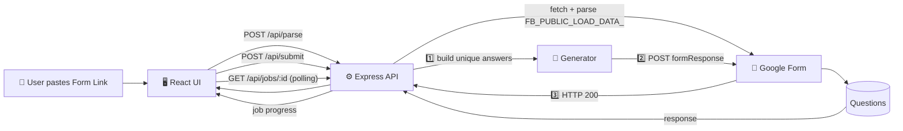

# 🎯 Form Filler

> **Automatically generate unique test responses for your public Google Form — no database, no setup, no sign-in.**

Form Filler parses any public Google Form, detects its questions, and submits **N unique random responses** directly to Google's form endpoint — with live progress tracking, cancellation support, and a clean web dashboard.

---

## ✨ Features

| Feature | Description |
| --- | --- |
| ⚡ **One-click parsing** | Paste a Google Form link and instantly see every question, type, and required flag |
| 🎲 **Unique random answers** | Every submission is guaranteed different — no duplicate responses |
| 📊 **Live progress** | Real-time progress bar, submitted / total / failed counters, and status badges |
| 🛑 **Cancel anytime** | Stop a running job without leaving the page |
| 🧠 **Smart answer generation** | Detects emails, names, phone numbers, ages, addresses, and more |
| 🧩 **Supports 9 question types** | Short answer, paragraph, multiple choice, dropdown, checkboxes, scale, grid, date & time |
| 🔒 **No storage** | Nothing is saved — submissions go straight to Google |

---

## 🎬 How it works



### 🎥 Animated data flow

<svg viewBox="0 0 800 260" xmlns="http://www.w3.org/2000/svg" width="100%" style="background:#0d1117;border-radius:12px;font-family:Segoe UI,system-ui,sans-serif">
  <defs>
    <marker id="arrow" viewBox="0 0 10 10" refX="9" refY="5" markerWidth="7" markerHeight="7" orient="auto-start-reverse">
      <path d="M 0 0 L 10 5 L 0 10 z" fill="#58a6ff"/>
    </marker>
    <linearGradient id="boxG" x1="0%" y1="0%" x2="100%" y2="100%">
      <stop offset="0%" stop-color="#1f6feb"/>
      <stop offset="100%" stop-color="#238636"/>
    </linearGradient>
    <linearGradient id="barG" x1="0%" y1="0%" x2="100%" y2="0%">
      <stop offset="0%" stop-color="#1f6feb"/>
      <stop offset="100%" stop-color="#238636"/>
    </linearGradient>
  </defs>

  <!-- Background grid -->
  <pattern id="grid" width="20" height="20" patternUnits="userSpaceOnUse">
    <circle cx="1" cy="1" r="1" fill="#21262d"/>
  </pattern>
  <rect width="800" height="260" fill="url(#grid)" rx="12"/>

  <!-- Node 1: Browser -->
  <g>
    <rect x="30" y="80" width="160" height="60" rx="10" fill="#161b22" stroke="#30363d"/>
    <text x="110" y="105" fill="#e6edf3" font-size="13" font-weight="600" text-anchor="middle">🌐 React UI</text>
    <text x="110" y="124" fill="#8b949e" font-size="11" text-anchor="middle">localhost:5173</text>
  </g>

  <!-- Node 2: API -->
  <g>
    <rect x="320" y="80" width="160" height="60" rx="10" fill="#161b22" stroke="#30363d"/>
    <text x="400" y="105" fill="#e6edf3" font-size="13" font-weight="600" text-anchor="middle">⚙️ Express API</text>
    <text x="400" y="124" fill="#8b949e" font-size="11" text-anchor="middle">localhost:5000</text>
  </g>

  <!-- Node 3: Google -->
  <g>
    <rect x="610" y="80" width="160" height="60" rx="10" fill="#161b22" stroke="#30363d"/>
    <text x="690" y="101" fill="#e6edf3" font-size="13" font-weight="600" text-anchor="middle">📄 Google Forms</text>
    <text x="690" y="120" fill="#8b949e" font-size="11" text-anchor="middle">/formResponse</text>
  </g>

  <!-- Arrow UI -> API -->
  <line x1="192" y1="110" x2="313" y2="110" stroke="#58a6ff" stroke-width="2" marker-end="url(#arrow)"/>
  <circle r="9" cy="110" cx="250" fill="#161b22" stroke="#58a6ff">
    <animate attributeName="cx" values="205;305" dur="2s" repeatCount="indefinite"/>
    <animate attributeName="cy" values="110;110" dur="2s" repeatCount="indefinite"/>
  </circle>
  <text x="250" y="95" fill="#58a6ff" font-size="10" text-anchor="middle">parse / submit</text>

  <!-- Arrow API -> Google -->
  <line x1="482" y1="110" x2="603" y2="110" stroke="#58a6ff" stroke-width="2" marker-end="url(#arrow)"/>
  <circle r="9" cy="110" cx="540" fill="#161b22" stroke="#a5d6ff">
    <animate attributeName="cx" values="495;595" dur="2s" begin="1s" repeatCount="indefinite"/>
    <animate attributeName="cy" values="110;110" dur="2s" begin="1s" repeatCount="indefinite"/>
  </circle>
  <text x="542" y="95" fill="#a5d6ff" font-size="10" text-anchor="middle">POST answers</text>

  <!-- Return arrow Google -> API (lower) -->
  <path d="M 690 145 L 690 180 L 400 180 L 400 145" fill="none" stroke="#3fb950" stroke-width="2" marker-end="url(#arrow)"/>
  <circle r="9" fill="#161b22" stroke="#3fb950">
    <animateMotion dur="2.5s" begin="0.5s" repeatCount="indefinite" path="M 690 145 L 690 180 L 400 180 L 400 145"/>
  </circle>
  <text x="550" y="172" fill="#3fb950" font-size="10" text-anchor="middle">HTTP 200 ✓</text>

  <!-- API -> UI return -->
  <path d="M 320 145 L 320 200 L 110 200 L 110 145" fill="none" stroke="#d2a8ff" stroke-width="2" marker-end="url(#arrow)"/>
  <circle r="9" fill="#161b22" stroke="#d2a8ff">
    <animateMotion dur="2s" begin="1.5s" repeatCount="indefinite" path="M 320 145 L 320 200 L 110 200 L 110 145"/>
  </circle>
  <text x="200" y="192" fill="#d2a8ff" font-size="10" text-anchor="middle">progress polling: GET /api/jobs/:id</text>

  <!-- Bottom progress bar -->
  <rect x="250" y="228" width="300" height="8" rx="4" fill="#21262d"/>
  <rect x="250" y="228" width="0" height="8" rx="4" fill="url(#barG)">
    <animate attributeName="width" values="0;300" dur="4s" repeatCount="indefinite"/>
  </rect>
  <text x="400" y="250" fill="#8b949e" font-size="10" text-anchor="middle">🔥 100% unique responses · in-memory only</text>
</svg>

---

## 🚀 Quick Start

### Prerequisites

- **Node.js** ≥ 18 (native `fetch`)
- **npm**

### 1. Install & run

```bash
# Install all dependencies (root + server + client)
npm run install-all

# Start both API (port 5000) and web UI (port 5173) together
npm run dev
```

> `install-all` runs `npm install` in the root, `server/`, and `client/` folders.
> `dev` uses [`concurrently`](https://www.npmjs.com/package/concurrently) to launch both processes.

### 2. Open the app

<kbd>http://localhost:5173</kbd>

### 3. Use it

1. **Paste** any public Google Form link — e.g. `https://docs.google.com/forms/d/e/…/viewform`
2. Click **Read form** → the app parses and displays every question, type, and required marker
3. Set the **number of submissions** (min 1, max 1000)
4. Optionally set a **delay between submissions** (0–5000 ms) to look more human
5. Click **Submit N responses** and watch live progress
6. Open your form's **Responses** tab — your new entries appear seconds later

---

## 🧠 How it works under the hood

1. **`POST /api/parse`** — downloads the form HTML and extracts the embedded `FB_PUBLIC_LOAD_DATA_` JSON blob, which contains every question and option with its `entry.<id>` field name.
2. **`POST /api/submit`** — starts an in-memory job. For each submission:
   - The generator builds **random answers** tailored to each question type (smart fills for emails, names, phones, ages, cities, etc.)
   - A `Set` of serialized answers guarantees **no two submissions are identical**
   - Responses are POSTed to the form's `/formResponse` endpoint with a browser `User-Agent`
3. **`GET /api/jobs/:id`** — the UI polls this endpoint every 600 ms to update the progress bar, counters, and errors.
4. **`POST /api/jobs/:id/cancel`** — flags a running job as cancelled; it stops at the next iteration.

### API endpoints

| Method | Endpoint | Description |
| --- | --- | --- |
| `POST` | `/api/parse` | Parse a Google Form and return its questions |
| `POST` | `/api/submit` | Start a new submission job |
| `GET` | `/api/jobs/:id` | Get live job status / progress |
| `POST` | `/api/jobs/:id/cancel` | Cancel a running job |

### Supported question types

| Type | Code | Supported |
| --- | :-: | :-: |
| Short answer | `0` | ✅ |
| Paragraph | `1` | ✅ |
| Multiple choice | `2` | ✅ |
| Dropdown | `3` | ✅ |
| Checkboxes | `4` | ✅ |
| Linear scale | `5` | ✅ |
| Grid | `7` | ✅ |
| Date | `9` | ✅ |
| Time | `10` | ✅ |
| Section break | `8` | ✅ (skipped) |
| File upload | `6` / `12` | ❌ |
| Image / video | `11` | ❌ |

---

## ⚠️ Limitations

- Form must be **public** — no sign-in required and not restricted to *"1 response per person"*.
- **File upload** questions are not supported.
- If a form only has choice questions, the **number of unique combinations is mathematically finite**; the run is automatically capped to that limit.
- Maximum **1000 submissions per run**.
- Jobs live **in server memory** for 30 minutes after finishing, then are cleaned up.

---

## 🛠️ Tech Stack

| Layer | Tech |
| --- | --- |
| **Frontend** | React 18 · Vite · Tailwind CSS |
| **Backend** | Node.js 18+ · Express 4 |
| **Parsing** | Regex extraction of `FB_PUBLIC_LOAD_DATA_` |
| **Submissions** | Native `fetch` → `formResponse` endpoint |

---

## 📁 Project Structure

```bash
.
├── client/               # React + Vite frontend
│   ├── src/
│   │   ├── App.jsx       # Main UI: parse, submit, progress, cancel
│   │   ├── main.jsx      # Entry point
│   │   └── styles.css    # Tailwind styles
│   └── vite.config.js   # Proxy /api → localhost:5000
│
├── server/               # Express backend
│   ├── index.js          # API routes + in-memory job runner
│   ├── formParser.js     # Google Form HTML → question model
│   └── generator.js      # Random + unique answer generation
│
├── package.json          # Root scripts (install-all, dev)
└── README.md
```

---

## ⚖️ Disclaimer

This tool is intended for **testing your own forms** with dummy data. Using it to spam forms you don't own may violate Google's Terms of Service. **Use responsibly.**

---

<div align="center">

**Made for developers who test forms — the fast way.** 🚀

</div>